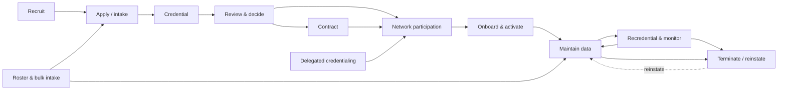

# PNM Provider Lifecycle

A **reference** lifecycle for orientation and scope selection. It is not the
target's lifecycle: stage names, order, statuses and hand-offs are always
discovered (D-5 status and temporal model, D-6 work model). Organisations
merge, split, skip or reorder these stages.

| Reference stage | Scenario domains | Records typically touched | Decisions that vary by organisation |
|---|---|---|---|
| Recruit | RC | Lead, Campaign | Who owns recruitment; adequacy standards (D-13) |
| Apply / intake | IN, RO | Application and case, provider anchor, identifiers, locations | Anchor (D-1); which records start staged (D-5); validation severity (A-7) |
| Credential | CR | Credential objects, adverse actions, files | Elements in scope (D-13); verification sources (D-12); case per stage or one case (D-6) |
| Review & decide | QC | Case, decision records | Clean-file rules; committee model; return rules (D-6) |
| Contract | CT | Contract, payment agreements, fee schedules | Whether contracting precedes or follows participation; licence (D-10) |
| Network participation | NW | Participation rows, tiers, provider–network–contract rows | Grain and derived rows (D-4); mandatory networks |
| Onboard & activate | OB | Staged records flipped to active; outbound sync | Activation rule and status mechanism (D-5); consumers (D-12) |
| Maintain data | PD, DS | Identifiers, locations, specialties, affiliations | Change review model (D-6); history (D-7) |
| Recredential & monitor | RE | Recredentialing case, credential updates, adverse actions | Cycle length and monitoring sources (D-13) |
| Terminate / reinstate | TR | Effective-to dates and statuses across records | Partial vs full; future-dated; provisional (D-5) |
| Delegated credentialing | DG | Rosters from delegates; oversight records | Delegation scope (D-13) |
| Provider service | SV | Messaging sessions, cases | Channels; agent licence (D-10) |

When an artifact describes a lifecycle, it draws it from the **discovered**
model (post-generation offer 8) and labels each stage `[Discovered]`,
`[Adapter]` or `[Assumed — confirm]`.
