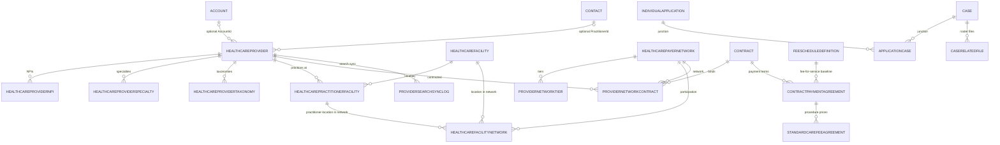

# PNM Product Baseline (Layer 1)

What Salesforce Health Cloud Provider Network Management ships — licences,
objects, verified fields, relationships, capabilities and APIs. **Official
Salesforce documentation only.** "Standard" in this skill means this baseline,
never a particular organisation's implementation.

Every exact claim carries a source ID from §6. Facts here are labelled
`[Product]` when they appear in an artifact.

## Contents

1. Licensing and access
2. Objects by domain
3. Verified field facts
4. Relationships
5. Shipped capabilities and APIs to consider before custom build
6. Sources and verification register

---

## 1. Licensing and access

Verified 2026-10-20 against S3 and S7.

- PNM objects need the **Health Cloud Provider Network Management Add-On**
  (platform licence plus user permission set licence) on top of the Health
  Cloud Platform licence. Users need the **Provider Network Management**
  permission set licence and the **Health Foundation** permission set. The
  data model is available from API 52.0. *(S3)*
- Objects that existed before the add-on but **require it** for use:
  ApplicationCase, IndividualApplication, InsurancePolicy, PersonEmployment,
  ProviderNetworkTier, ProviderNetworkContract, CareFeeScheduleItem,
  FeeScheduleDefinition, ContractPaymentAgreement, the care-fee agreement
  objects (Standard, Categorized, Capitation, Bundled, Percentile-based,
  Preventive) and SharedSavingPaymentAgreement. *(S3)*
- The add-on **adds fields** to existing objects — see §3.1. *(S3)*
- Portal users need Customer Community or Customer Community Plus, the
  **Provider Network Management for Experience Cloud Sites** and **Omnistudio
  User** permission sets, and permission to run OmniStudio components
  off-platform. *(S7)*
- Roster File Mapping needs **Data 360** (Data Processing Engine); GenAI
  field-mapping suggestions need the Einstein generative AI add-ons. *(S7)*

**Licence rule.** A licence-gated object or field is used only after the
licence is `[Discovered]` (seen in the target org's licences, permission set
licences or describe results) or `[Adapter]`-confirmed. Otherwise it is
`[Assumed — confirm]`, a Clarification Question is raised, and the artifact
offers an option that does not depend on the licence.

---

## 2. Objects by domain

Object names are grounded in the PNM and Provider Relationship Management
data-model pages (S1, S2). **Field-level status** says whether exact fields
may be used as `[Product]`:

- **Verified** — fields in §3 were read from the object's reference page.
- **Name only** — the object is documented, but its field page has not yet
  been verified for this package. Name the object; label any field
  `[Assumed — confirm]` until checked against official documentation.

| Domain | Object | Field-level status | Gate |
|---|---|---|---|
| Provider core | HealthcareProvider | Verified (S4) | — |
| Provider core | Account | Platform standard | — |
| Provider core | Contact | Platform standard | — |
| Provider core | AccountContactRelationship | Platform standard | — |
| Identifiers | HealthcareProviderNpi | Name only | — |
| Identifiers | IdentityDocument | Name only | — |
| Locations | HealthcareFacility | Name only | — |
| Locations | HealthcarePractitionerFacility | Verified (S4) | — |
| Locations | Location, AssociatedLocation | Platform standard | — |
| Locations | OperatingHours, TimeSlot | Platform standard | — |
| Specialty & taxonomy | HealthcareProviderSpecialty | Name only | — |
| Specialty & taxonomy | HealthcareProviderTaxonomy | Name only | — |
| Specialty & taxonomy | CareSpecialty, CareTaxonomy, CareSpecialtyTaxonomy | Name only | — |
| Specialty & taxonomy | CareProviderFacilitySpecialty | Name only | — |
| Services & conditions | CareService, HealthcareProviderService, HealthcareServiceDetail | Name only | — |
| Services & conditions | HlthCareProvTreatedCondition (API 59.0+) | Name only | — |
| Credentials | BusinessLicense | Partial — add-on fields verified (S3) | — |
| Credentials | BoardCertification | Name only | — |
| Credentials | PersonEducation | Partial — add-on fields verified (S3) | — |
| Credentials | PersonEmployment | Name only | PNM add-on |
| Credentials | CareProviderAdverseAction | Partial — add-on fields verified (S3) | — |
| Credentials | Accreditation, Award | Name only | — |
| Networks & participation | HealthcarePayerNetwork | Name only | — |
| Networks & participation | ProviderNetworkTier | Verified (S4) | PNM add-on |
| Networks & participation | HealthcareFacilityNetwork | Verified (S4) | — |
| Networks & participation | ProviderNetworkContract | Verified (S4) | PNM add-on |
| Contracting & reimbursement | Contract | Platform standard; PNM adds limited access (S7) | — |
| Contracting & reimbursement | ContractPaymentAgreement | Verified (S4) | PNM add-on |
| Contracting & reimbursement | FeeScheduleDefinition | Name only | PNM add-on |
| Contracting & reimbursement | CareFeeScheduleItem | Name only | PNM add-on |
| Contracting & reimbursement | StandardCareFeeAgreement | Verified (S4) | PNM add-on |
| Contracting & reimbursement | Categorized, Capitation, Bundled, Percentile-based, Preventive care-fee agreements; SharedSavingPaymentAgreement | Name only | PNM add-on |
| Application & case | IndividualApplication | Name only | PNM add-on |
| Application & case | ApplicationCase (junction Case ↔ IndividualApplication) | Name only | PNM add-on |
| Application & case | Case | Platform standard | — |
| Application & case | CaseRelatedFile (API 62.0+) | Name only | — |
| Application & case | InsurancePolicy | Name only | PNM add-on |
| Search | CareProviderSearchableField, CareProviderSearchConfig | Name only | — |
| Search | ProviderSearchSyncLog | Verified (S4) | — |

---

## 3. Verified field facts

Verified 2026-10-20 against the object reference pages (S4) and the access
page (S3). Only these fields may appear as `[Product]` without a fresh check.

### 3.1 Fields added by the PNM add-on (S3)

| Object | Fields |
|---|---|
| BusinessLicense | IsPrimaryLicense, IssueDate, LicenseNumber |
| CareProviderAdverseAction | ActionIssueDate, IncidentDate, IncidentReportedDate, InsurancePolicyNumber, InsuranceProviderName, PenaltyAmount, RegulatoryBody, RegulatoryBodyType |
| PersonEducation | InstitutionAddress, ProgramName, CertificateIdentifier |

### 3.2 Object fields (S4)

**HealthcareProvider** — business-level details for a practitioner or an
organisation: AccountId, PractitionerId (Contact), ProviderType, ProviderClass
(values include IPA, Medical Group, Solo Practitioner), EffectiveFrom,
EffectiveTo, InitialStartDate, TerminationDate, TerminationReason,
SourceSystem, SourceSystemIdentifier, TotalLicensedBeds.

**HealthcarePractitionerFacility** — a practitioner at a location:
HealthcareProviderId, HealthcareFacilityId, AccountId, EffectiveFrom,
EffectiveTo, InitialStartDate, IsActive, IsPrimaryFacility,
IsPrimaryCarePhysician, IsDirectoryPrint, plus age and gender restriction
fields.

**HealthcareFacilityNetwork** — network participation: PayerNetworkId,
HealthcareFacilityId, PractitionerFacilityId, PractitionerId,
HealthcareProviderId, AccountId, EffectiveFrom, EffectiveTo, IsActive,
PanelLimit, PanelStatus, plus age and gender restriction fields.

**ProviderNetworkTier** — ProviderNetworkId (HealthcarePayerNetwork), IsActive.

**ProviderNetworkContract** — binds a provider and a network through a
Contract; StartDate, EndDate. Written by the shipped Network Participation
component.

**ContractPaymentAgreement** — master-detail to Contract.
AgreementType: Bundled, Capitation, Categorized, Percentile Based, Preventive,
Shared Saving, Standard Care Fee. LineofBusiness: Commercial, Medi-Cal,
Medicaid, Medicare. Status: Draft, Activated, Deactivated.
FeeScheduleDefinitionId, StandardFeeCalculationPercentage,
EligibleProcedureCodeList.

**StandardCareFeeAgreement** — FacilityPrice, NonFacilityPrice.

**ProviderSearchSyncLog** — SyncStatus (Success, Failure), Message, LastSync.

> Picklist values above are the **product** values. A target org may restrict
> or extend them; an artifact uses the target's values once `[Discovered]`.

---

## 4. Relationships

Optional lookups are shown as optional — a target org may populate only some.

---

## 5. Shipped capabilities and APIs to consider before custom build

Verified 2026-10-20. These are rung 0 of the build-technology ladder.

| Capability | What it is | Source |
|---|---|---|
| Provider Network Management app | Lightning app spanning recruiting, credentialing and contracting | S7 |
| Shipped OmniScripts | Provider recruitment / registration; Primary Source Verification | S7 |
| Network Participation component | Creates ProviderNetworkContract records | S4 |
| Contracts in the PNM licence | Approval workflow, version management, e-signature integration | S7 |
| DocuSign and reCAPTCHA | E-signature on applications; bot protection on registration | S7 |
| Roster File Mapping | Data Processing Engine on Data 360 loads roster files into PNM objects; canonical template; GenAI mapping suggestions with confidence scores; Email-to-Case and Experience Cloud intake; one CaseRelatedFile per file | S7 |
| Upsert Provider API (`/connect/health/providers`) | Business-level upsert of practitioners with NPI, specialty, taxonomy and more; per-provider partial success | S8 |
| Provider Search API and index | Search by name, specialties, plan types, accepting new patients, languages, gender, licence jurisdiction, NPI, provider type | S8 |
| CAQH | Pre-fill support; MuleSoft connector for ProView / DirectAssure roster operations | S6, S9 |
| Work guides, Flow Orchestration, queues | Guided credentialing, contracting and go-live work; routing by provider attributes | S6 |
| CRM Analytics | Network adequacy and recruiting dashboards | S6 |
| Agentforce in the payer contact center | Agent grounded in provider-network data for contact-centre inquiries | S11 |

**No shipped credentialing agent** was found in official release notes
(checked 2026-10-20). Agentforce credentialing assistance is designed as
custom agent topics and actions and labelled `[Proposed]`.

### Accreditation reference points (S10)

Used by the Compliance & Audit check (A-4) only when the target's compliance
scope (D-13) includes them: primary source verification elements (licence,
DEA/CDS, education and training, board certification, work history,
malpractice history, sanctions), credentialing committee review, a
recredentialing cycle of at most 36 months, ongoing monitoring of sanctions,
complaints and adverse events, and delegation oversight. Never assert an
accreditation requirement that the target has not placed in scope.

---

## 6. Sources and verification register

| ID | Source | Covers | Verified |
|---|---|---|---|
| S1 | [PNM data model](https://developer.salesforce.com/docs/atlas.en-us.health_cloud_object_reference.meta/health_cloud_object_reference/hc_pnm_data_model.htm) | PNM object list, licence gating | 2026-10-20 |
| S2 | [Provider Relationship Management data model](https://developer.salesforce.com/docs/atlas.en-us.health_cloud_object_reference.meta/health_cloud_object_reference/hc_provider_data_model_overview.htm) | Provider, facility, specialty, credential, network objects | 2026-10-20 |
| S3 | [Access to PNM](https://developer.salesforce.com/docs/atlas.en-us.health_cloud_object_reference.meta/health_cloud_object_reference/hc_provider_data_model_permissions.htm) | Add-on licence; fields the licence adds | 2026-10-20 |
| S4 | Object reference pages: [HealthcareProvider](https://developer.salesforce.com/docs/atlas.en-us.health_cloud_object_reference.meta/health_cloud_object_reference/sforce_api_objects_healthcareprovider.htm), [HealthcarePractitionerFacility](https://developer.salesforce.com/docs/atlas.en-us.health_cloud_object_reference.meta/health_cloud_object_reference/sforce_api_objects_healthcarepractitionerfacility.htm), [HealthcareFacilityNetwork](https://developer.salesforce.com/docs/atlas.en-us.life_sciences_dev_guide.meta/life_sciences_dev_guide/sforce_api_objects_healthcarefacilitynetwork.htm), [ProviderNetworkContract](https://developer.salesforce.com/docs/atlas.en-us.health_cloud_object_reference.meta/health_cloud_object_reference/sforce_api_objects_providernetworkcontract.htm), [ProviderNetworkTier](https://developer.salesforce.com/docs/atlas.en-us.health_cloud_object_reference.meta/health_cloud_object_reference/sforce_api_objects_providernetworktier.htm), [ContractPaymentAgreement](https://developer.salesforce.com/docs/atlas.en-us.health_cloud_object_reference.meta/health_cloud_object_reference/sforce_api_objects_contractpaymentagreement.htm), [StandardCareFeeAgreement](https://developer.salesforce.com/docs/atlas.en-us.health_cloud_object_reference.meta/health_cloud_object_reference/sforce_api_objects_standardcarefeeagreement.htm), [ProviderSearchSyncLog](https://developer.salesforce.com/docs/atlas.en-us.health_cloud_object_reference.meta/health_cloud_object_reference/sforce_api_objects_providersearchsynclog.htm) | Field-level facts in §3.2 | 2026-10-20 |
| S5 | Reference pages for the "Name only" objects in §2 | Field catalog | **Not yet verified** — next release |
| S6 | [Trailhead: Provider Network Management](https://trailhead.salesforce.com/content/learn/modules/provider-network-management-with-health-cloud) | Reference lifecycle, personas, work guides | 2026-10-20 |
| S7 | Salesforce Help and release notes: [Roster File Mapping](https://help.salesforce.com/s/articleView?id=ind.hc_admin_provider_network_management_roster_file_mapping.htm&type=5), [GenAI roster field mapping](https://help.salesforce.com/s/articleView?id=release-notes.rn_health_automate_field_mapping_with_einstein.htm&release=254&type=5), [PNM enhancements](https://help.salesforce.com/s/articleView?id=release-notes.rn_health_pnm_enhancements.htm&release=250&type=5), [PNM contract lifecycle](https://help.salesforce.com/s/articleView?id=release-notes.rn_health_pnm.htm&release=248&type=5), [Experience Cloud user for PNM](https://help.salesforce.com/s/articleView?id=ind.hc_admin_provider_network_management_create_customer_community_user.htm&type=5) | Feature inventory, prerequisites | 2026-10-20 |
| S8 | [Upsert Provider API](https://developer.salesforce.com/docs/atlas.en-us.life_sciences_dev_guide.meta/life_sciences_dev_guide/hc_upsert_provider_api.htm), [Provider Search criteria input](https://developer.salesforce.com/docs/atlas.en-us.health_cloud_object_reference.meta/health_cloud_object_reference/connect_requests_provider_search_criteria_input_representation.htm) | API options | 2026-10-20 |
| S9 | [MuleSoft CAQH Connector](https://docs.mulesoft.com/caqh-connector/latest/) | ProView / DirectAssure operations | 2026-10-20 |
| S10 | [NCQA Credentialing FAQ](https://www.ncqa.org/programs/health-plans/credentialing/faqs/), [NCQA Credentialing eBook 2025](https://wpcdn.ncqa.org/www-prod/NCQA-Credentialing-eBook-2025.pdf) | Verification elements, committee, recredentialing, monitoring, delegation | 2026-10-20 |
| S11 | [Summer '26 Release in a Box](https://www.salesforce.com/en-us/wp-content/uploads/sites/4/documents/release-notes/summer26-release-in-a-box.pdf) | Payer contact center with Agentforce | 2026-10-20 |

Re-verify every row once per Salesforce release; a row older than 180 days is
flagged by the validator.
